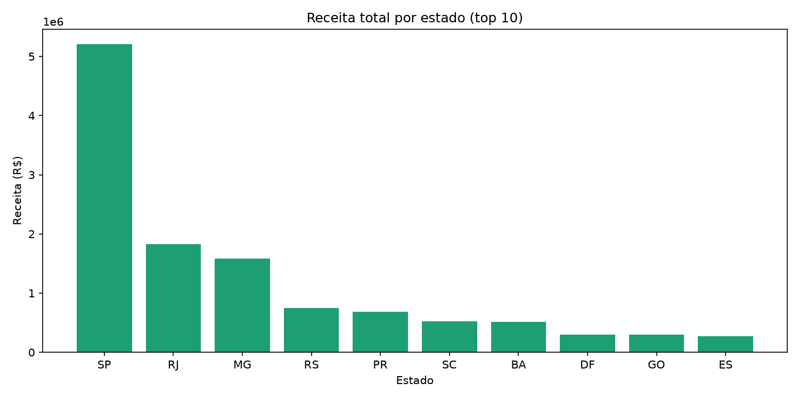
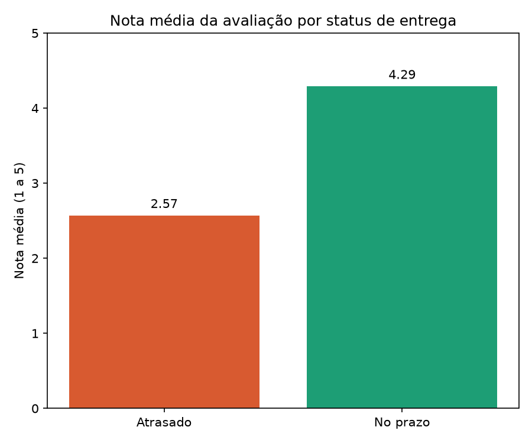
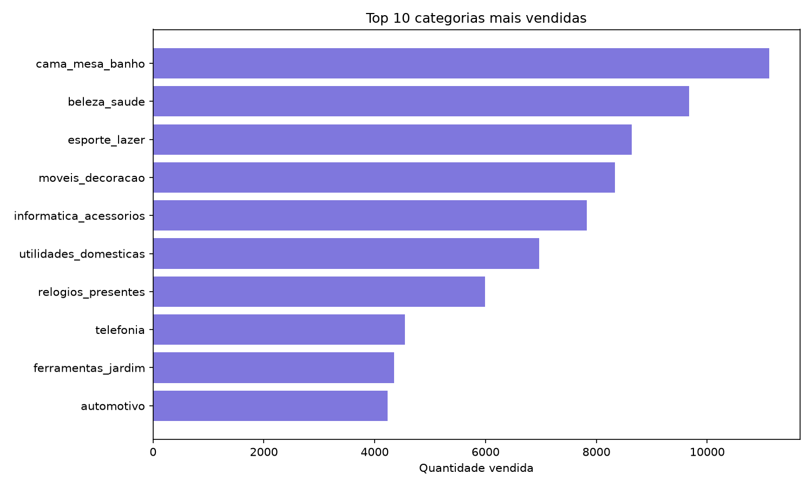

# Análise de E-commerce com Python e SQL: Olist

Projeto de análise de dados sobre ~100 mil pedidos reais de um marketplace brasileiro (2016 a 2018). Os dados foram carregados em um banco SQLite, explorados com consultas SQL (JOINs entre várias tabelas) e visualizados em Python. No final, um modelo simples de Machine Learning tenta prever atrasos na entrega.

**Ferramentas:** Python · SQL (SQLite) · Pandas · Matplotlib · Scikit-learn · Jupyter Notebook

## Base de dados

[Brazilian E-Commerce Public Dataset by Olist](https://www.kaggle.com/datasets/olistbr/brazilian-ecommerce) (Kaggle). Foram usadas 7 tabelas relacionadas: `customers`, `orders`, `order_items`, `products`, `sellers`, `order_reviews` e `order_payments`.

## Perguntas respondidas

### 1. Quais estados geram mais receita?



São Paulo lidera com mais de R$ 5,2 milhões em receita, quase 3x o segundo colocado (Rio de Janeiro, R$ 1,8 milhão), seguido por Minas Gerais. As vendas são fortemente concentradas no Sudeste.

### 2. Atraso na entrega afeta a satisfação do cliente?



Sim, e de forma intensa: pedidos entregues no prazo têm nota média de **4,29**, enquanto pedidos atrasados caem para **2,57**. Foram 7.701 pedidos atrasados na análise, uma amostra grande o suficiente para a diferença não ser coincidência.

### 3. Quais categorias de produto mais vendem?



`cama_mesa_banho` lidera, seguida de `beleza_saude` e `esporte_lazer`. Categorias de consumo recorrente e ticket baixo dominam o volume de vendas.

## Modelo de Machine Learning: prevendo atrasos

**Objetivo:** prever se um item de pedido será entregue com atraso, usando preço, valor do frete e prazo estimado de entrega como variáveis.

**Modelo:** Regressão Logística (Scikit-learn), com divisão de 80% treino e 20% teste.

| Versão | Acurácia | Recall (atrasado) | Precision (atrasado) |
|---|---|---|---|
| Modelo padrão | 91,9% | 0,00 | 0,00 |
| Com `class_weight='balanced'` | 57,3% | 0,56 | 0,10 |

**Aprendizados:**

- Apenas cerca de 8% dos pedidos atrasam (classes desbalanceadas). O primeiro modelo teve 92% de acurácia, mas isso era enganoso: ele simplesmente nunca previa atraso.
- Ao balancear os pesos das classes, o modelo passou a identificar 56% dos atrasos reais, ao custo de mais falsos alarmes (trade-off entre precision e recall).
- Com apenas 3 variáveis, o poder preditivo é limitado.

**Próximos passos possíveis:** adicionar variáveis como categoria e peso do produto, mês da compra e se cliente e vendedor estão no mesmo estado; testar modelos baseados em árvores (Random Forest); ajustar o limiar de decisão.

## Como reproduzir

1. Clone o repositório e crie um ambiente virtual:
   ```
   python -m venv venv
   venv\Scripts\activate
   pip install -r requirements.txt
   ```
2. Baixe os CSVs do [dataset no Kaggle](https://www.kaggle.com/datasets/olistbr/brazilian-ecommerce) e coloque-os na pasta `data/`.
3. Abra o `explorar.ipynb` e execute as células em ordem. O banco `olist.db` será criado automaticamente.

## Autor

**Vitor da Silva Coutinho de Medeiros**
[LinkedIn](https://www.linkedin.com/in/vitormedeiros11) · [GitHub](https://github.com/VitorCoutinho11)
